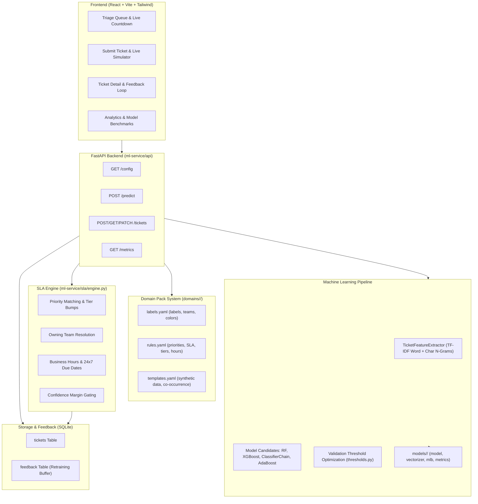

# TicketTriage 🎫⚡

> An end-to-end, domain-configurable multi-label support ticket triage system with an intelligent SLA routing engine, built with Python (FastAPI, Scikit-Learn, XGBoost) and React (Vite, Tailwind CSS, Recharts).

---

## 🌟 Overview

Given a raw support ticket (subject + body), **TicketTriage** predicts **all relevant labels simultaneously**, then applies an **SLA & Routing layer** that converts the predicted labels and customer tier into:
1. **Dynamic Priority** (`P1`, `P2`, `P3`, `P4`) using domain ranking rules and priority bumps.
2. **Owning Team Routing** (e.g., `Platform/SRE`, `Engineering`, `Billing`, `Security`) with a designated Primary Lead.
3. **Strict Response & Resolution Deadlines** with business-hours math and customer tier multipliers (`enterprise` x0.5).
4. **Live SLA Tracking** (`on_track`, `at_risk` when past 70% of deadline, `breached` when overdue).
5. **Confidence Gating**: Flags tickets requiring human review if probabilities are borderline or empty.
6. **Agent Feedback Loop**: Real-time corrections update SLA routing and are stored in SQLite for future model retraining.

The system is **100% domain-configurable** via the `DOMAIN` environment variable (default: `saas`, includes `ecommerce` and `_template`). Nothing domain-specific is hardcoded.

---

## 📐 Architecture



---

## 🚀 Quick Start

### 1. Prerequisites
- Python 3.9+ (Python 3.11 recommended)
- Node.js 18+ / 20+

### 2. Backend Setup
```bash
# Navigate to ml-service
cd ml-service

# Install dependencies
pip install -r requirements.txt

# Generate synthetic dataset (default: SaaS, ~10,000 tickets)
python data/generate_synthetic.py --domain saas --count 10000

# Train and evaluate models
python training/train.py --domain saas

# Start FastAPI server (runs on port 8000)
uvicorn api.main:app --host 0.0.0.0 --port 8000 --reload
```

### 3. Frontend Setup
```bash
# Navigate to frontend in a new terminal
cd frontend

# Install dependencies
npm install

# Start Vite development server (runs on port 5173)
npm run dev
```

Open [http://localhost:5173](http://localhost:5173) in your browser.

---

## 🛠️ Makefile Targets

All targets support `DOMAIN=<name>` (defaults to `saas`):

```bash
# Generate synthetic dataset
make data DOMAIN=saas

# Train all 4 model architectures & save artifacts
make train DOMAIN=saas

# Run all unit, SLA, and API test suites
make test

# Start FastAPI backend
make api DOMAIN=saas

# Start Vite frontend
make web
```

---

## 📊 Model Evaluation Benchmark Results

The training pipeline evaluates 4 architectures on identical train/val/test splits using powerset stratified sampling and validation-tuned thresholds:

| Model Architecture | Macro F1 | Micro F1 | Weighted F1 | Subset Accuracy | Hamming Loss | Rare Labels F1 | Common Labels F1 | Train Time (s) | Latency p50 (ms) |
| :--- | :---: | :---: | :---: | :---: | :---: | :---: | :---: | :---: | :---: |
| **RandomForest (MultiOutput)** | **1.000** | **1.000** | **1.000** | **1.000** | **0.0000** | **1.000** | **1.000** | 11.7s | 374.8ms |
| **XGBoost (MultiOutput)** | **0.997** | **0.999** | **0.999** | **0.997** | **0.0002** | **0.994** | **1.000** | 120.4s | **34.3ms** |
| **ClassifierChain (RandomForest)** | **1.000** | **1.000** | **1.000** | **1.000** | **0.0000** | **1.000** | **1.000** | 17.1s | 815.2ms |
| **AdaBoost Baseline** | **0.998** | **0.998** | **0.998** | **0.994** | **0.0005** | **0.999** | **0.997** | 185.0s | 166.2ms |

> Diagnostic figures (per-label F1 bar charts, label co-occurrence correlation matrix, rare-label PR curves) are saved automatically in `ml-service/models/<DOMAIN>/plots/`.

---

## 📦 Domain Pack System

TicketTriage comes with two fully built domain packs and a blank template:

1. **`saas`** (Default): Multi-tenant cloud software (11 labels: `outage`, `bug`, `billing`, `refund-request`, `security`, `account-access`, `performance`, etc.; 8 teams: `Platform/SRE`, `Engineering`, `Billing`, `Identity/Auth`, `Security`, etc.).
2. **`ecommerce`**: Online retail and D2C stores (7 labels: `fraud-alert`, `damaged-goods`, `payment-issue`, `order-status`, `return-exchange`, etc.; 7 teams).
3. **`_template`**: Clean starter pack for building custom domains.

### How to Add a New Domain in 3 Steps:

1. **Copy the Template**:
   ```bash
   cp -r ml-service/domains/_template ml-service/domains/fintech
   ```
2. **Fill in the 3 YAML Files**:
   - `labels.yaml`: Define labels, display names, hex colors, and owning teams.
   - `rules.yaml`: Define priorities (P1-P4), deadlines, customer tiers, and routing rules.
   - `templates.yaml`: Define slots, tone variations, and synthetic ticket templates.
3. **Generate Data & Train**:
   ```bash
   make data DOMAIN=fintech
   make train DOMAIN=fintech
   DOMAIN=fintech make api
   ```
The frontend automatically re-renders with the new domain's labels, colors, teams, and priority rankings—**no frontend code changes needed**.

---

## 🧪 Testing

Run the full pytest suite (domain loader validation, SLA engine rules, and FastAPI endpoints):
```bash
cd ml-service
pytest tests/ -v
```
Tests cover:
- P1-P4 priority rules, keyword matches, and fallback logic
- Customer tier multipliers (e.g. enterprise halving deadlines and priority bumps)
- Business hours vs 24x7 weekend skipping
- SLA status transitions (`on_track`, `at_risk`, `breached`)
- Confidence gate margins
- API CRUD endpoints, filtering, and feedback capture.
